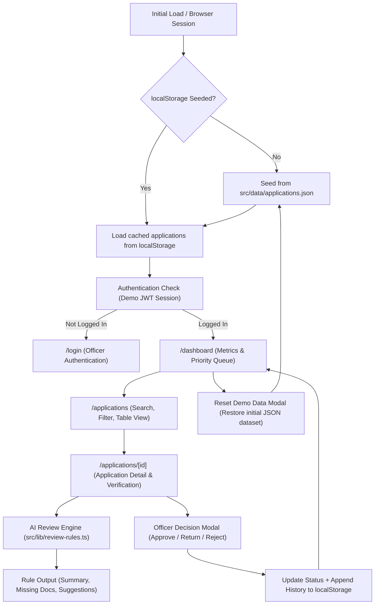

# தமிழ்நாடு அரசு — ஓட்டுநர் உரிம விண்ணப்ப மறுஆய்வு முகப்புப்பலகை
### Tamil Nadu Driving Licence Application Review Officer Dashboard.

A responsive, government-grade administrative dashboard built with **Next.js (App Router)**, **TypeScript**, **Tailwind CSS**, and **Lucide React**. Designed specifically for Motor Vehicle Inspectors (MVI) and Regional Transport Officers (RTO) in Tamil Nadu to review, verify, and decide upon driving licence applications in natural, professional Tamil.

---

## 1. Project Overview
This project models an administrative review workflow for Tamil Nadu transport department officers. It provides an intuitive, Tamil-first dashboard featuring:
- **Instant analytics & pending metrics**
- **Priority-based queue management**
- **Comprehensive applicant verification & document checklist**
- **Deterministic, rule-based AI review assistance**
- **Officer decision workflows (Approve, Reject, Return) with mandatory rationale**
- **Full decision history audit trails**
- **Client-side JWT-compatible session authentication**
- **Browser localStorage persistence with sample data reset capability**
- **Custom Tamil Nadu Government RTO emblem & driving licence favicon (`/icon.svg` & `/favicon.ico`)**

---

## 2. Problem Statement
Manual driving licence application review is time-consuming and error-prone, requiring officers to cross-verify age restrictions, mandatory document submissions (like Form 1A medical certificates for seniors), and previous violation records. This dashboard accelerates the review process by highlighting inconsistencies, flagging missing documents, providing rule-based AI suggestions, and recording an unalterable audit trail for transparent governance.

---

## 3. Target Users and Beneficiaries
- **Motor Vehicle Inspectors (MVI):** Conduct practical test evaluations and verify identity and driving school certificates.
- **Assistant Regional Transport Officers (ARTO) & RTOs:** Issue final approvals, order returns for corrections, or reject invalid applications.
- **RTO Administrative Supervisors:** Monitor district-level application turnaround, pending queues, and high-priority cases.
- **Tamil Nadu Citizens (Beneficiaries):** Benefit from faster, transparent, and error-free licence approvals with clear reasons provided when corrections are needed.

---

## 4. Driving Licence Workflow Selected
The system models three critical driving licence processes under the Motor Vehicles Act:
1. **பழகுநர் உரிமம் (Learner's Licence - LL):** Age checks (18+ for LMV, 16+ for gearless 50cc), mock test verification, and address validation.
2. **ஓட்டுநர் உரிமம் (Permanent Driving Licence - DL):** 30-day minimum holding of valid LLR, Form 5 driving school certification, and track test completion.
3. **உரிமம் புதுப்பித்தல் (Licence Renewal - Renewal):** Grace period verification (within 1 year of expiry), Form 1 self-declaration, and mandatory **Form 1A medical fitness certificate** for applicants aged 40 and above.

---

## 5. Features
- **Tamil-First Interface (தமிழ் இடைமுகம்):** 100% of officer-facing navigation, metric cards, status tags, document checklists, AI suggestions, confirmation modals, error messages, and user manual are in natural, professional Tamil.
- **Instant Metrics Dashboard:** Displays Total Applications, Pending, Under Review, High Priority / Immediate Attention, Approved, Returned, and Rejected counts.
- **Multi-Parametric Filter & Search:** Search by application number (e.g., `TN-2026-LL-10042`) or applicant name, with instant filters for Application Type, Status, District, and Priority.
- **Priority Review Queue:** One-click queue focusing on urgent cases, government service test applicants, and flagged records.
- **Rule-Based AI Assistant:** Deterministic analysis offering summaries, missing document alerts, risk highlights, review suggestions, and step-by-step next actions.
- **Decision Workflow with Mandatory Rationale:** Confirmation modal before finalization. Reasons are **strictly required** for rejections and returns.
- **Decision Audit History:** Complete timeline recording officer name, role, timestamp, action, rationale, and internal notes.
- **Demo Data Reset:** Officers can test changes and immediately restore the original 14 sample applications at any time.
- **Dedicated User Manual (பயனர் கையேடு):** Comprehensive 10-section operational guide embedded directly in the application.

---

## 6. Technology Stack
- **Framework:** Next.js 16 (App Router)
- **Language:** TypeScript 5 (.tsx / .ts) with strict type checking
- **Styling:** Tailwind CSS v4 with custom Tamil typography fallback
- **Icons:** Lucide React
- **Authentication:** Demo JWT-compatible token generation with 2-hour expiry handling
- **Persistence:** Browser `localStorage` with automatic initial JSON seeding
- **AI Engine:** Deterministic rule-based evaluation module (`src/lib/review-rules.ts`)
- **Backend / External Services:** None (Zero external dependencies or paid APIs required)

---

## 7. Architecture and Data Flow



---

## 8. Folder Structure
```text
web/
├── public/
│   ├── favicon.ico             # 32x32 custom Tamil Nadu RTO emblem icon
│   └── icon.svg                # Vector SVG icon
├── src/
│   ├── app/
│   │   ├── applications/
│   │   │   ├── [id]/
│   │   │   │   └── page.tsx    # விண்ணப்ப விவரங்கள் & முடிவுப் பகுதி
│   │   │   └── page.tsx        # விண்ணப்பங்கள் பட்டியல் & வடிகட்டிகள்
│   │   ├── dashboard/
│   │   │   └── page.tsx        # முகப்புப் பலகை & புள்ளிவிவரங்கள்
│   │   ├── login/
│   │   │   └── page.tsx        # தமிழ் அரசு பாணி உள்நுழைவுத் திரை
│   │   ├── manual/
│   │   │   └── page.tsx        # முழுமையான தமிழ் பயனர் கையேடு
│   │   ├── favicon.ico         # Custom RTO ICO
│   │   ├── globals.css         # Styling & Tamil typography
│   │   ├── icon.svg            # Custom RTO vector icon
│   │   ├── layout.tsx          # Root layout & metadata
│   │   └── page.tsx            # Session check & redirect
│   ├── components/
│   │   ├── AiReviewPanel.tsx   # AI தானியங்கி வழிகாட்டி பேனல்
│   │   ├── DecisionModal.tsx   # முடிவு உறுதிப்படுத்தல் உரையாடல் பெட்டி
│   │   ├── Navbar.tsx          # அரசு தலைப்பு & அலுவலர் சுயவிவரம்
│   │   ├── PriorityBadge.tsx   # முன்னுரிமை பட்டிகள் (High/Med/Low)
│   │   ├── ResetConfirmModal.tsx # மாதிரித் தரவு மீட்டமைப்பு உறுதி
│   │   ├── Sidebar.tsx         # வழிசெலுத்தல் பக்கப் பட்டை
│   │   ├── StatusBadge.tsx     # விண்ணப்ப நிலை பட்டிகள்
│   │   └── TypeBadge.tsx       # உரிம வகை பட்டிகள் (LL/DL/Renewal)
│   ├── data/
│   │   ├── applications.json   # 14 மாதிரி விண்ணப்பங்கள் (JSON format)
│   │   ├── initial-applications.ts # Typed dataset module
│   │   ├── officers-data.ts    # Demo officers typed module
│   │   └── officers.json       # மாதிரி அலுவலர்கள் (JSON format)
│   └── lib/
│       ├── auth.ts             # Demo JWT creation, verification, session
│       ├── review-rules.ts     # Deterministic AI review engine
│       ├── storage.ts          # JSON seeding & browser persistence
│       └── types.ts            # TypeScript data contracts & interfaces
├── next.config.ts
├── package.json
├── tsconfig.json
└── README.md
```

---

## 9. Sample Data Design
The dataset includes **14 realistic Tamil Nadu driving licence records** spanning various districts (Chennai, Coimbatore, Madurai, Tiruchirappalli, Salem, Tirunelveli, Thanjavur, Erode, Vellore, Dindigul, Kanchipuram, Kanyakumari).

Key test scenarios represented:
1. **`TN-2026-LL-10042` (க. அன்பரசன் - சென்னை):** Age 19, all verified documents, full mock test passed -> *Ready for Approval*.
2. **`TN-2026-RN-30114` (வ. சிவகுமார் - கோயம்புத்தூர்):** Age 48, missing mandatory Form 1A medical certificate -> *Returned for corrections*.
3. **`TN-2026-RN-30299` (இரா. முத்தையா - சேலம்):** Age 62, failed medical vision test -> *Legally Rejected*.
4. **`TN-2026-LL-10088` (த. திவ்யா - ஈரோடு):** Age 17, applied for LMV (min age 18 required) -> *AI flags age discrepancy*.
5. **`TN-2026-DL-21250` (ரா. செல்வேந்திரன் - கன்னியாகுமரி):** LLR expired past 6 months -> *Returned to take fresh LLR*.
6. **`TN-2026-DL-21310` (பெ. மணிகண்டன் - கோயம்புத்தூர்):** High-priority government candidate -> *Under Review*.

---

## 10. AI-Assisted Review: Rules & Limitations
The AI review panel is **deterministic and rule-based**. It runs entirely in the browser without calling external APIs or LLMs.

### Evaluated Rules:
1. **Document Verification:** Confirms identity, address, and test records. Flags missing or rejected documents.
2. **Age Thresholds:** Enforces minimum 18 years for LMV four-wheelers (Motor Vehicles Act Section 4).
3. **LLR Validity for DL:** Verifies that a learner's licence was held for at least 30 days and has not exceeded 180 days.
4. **Senior Medical Rules:** Enforces mandatory Form 1A doctor certificate for licence renewals for applicants aged 40+.
5. **Transparency Disclaimer:** Prominently displays:
   > *“விதிமுறை அடிப்படையிலான தானியங்கி உதவி — இறுதி முடிவு அலுவலருடையது.”*
   *(Rule-based automated assistance — Final decision rests with the officer).*

---

## 11. Demo Authentication Limitations
- **Token Mechanism:** Uses Base64URL-encoded JWT structure (`header.payload.signature`) with standard claims (`sub`, `username`, `name`, `role`, `rtoOffice`, `exp`, `iat`).
- **Demo Limitation:** In a static, browser-only environment without a server backend, signed private keys cannot be securely kept secret. This implementation provides realistic session expiry (2 hours) and route protection for demonstration purposes, but should never be portrayed as production-grade authentication. Real production systems require OAuth 2.0 / OIDC backed by Tamil Nadu State e-Governance Agency (TNeGA) or Parivahan backend services.

---

## 12. Data Persistence and Reset Behaviour
- On first application visit, data is seeded from the sample dataset into browser `localStorage`.
- All decisions (approvals, rejections, returns, officer notes, timestamps) persist across page reloads and browser sessions.
- Clicking **"மாதிரித் தரவை மீட்டமை"** in the top navigation opens a confirmation dialog that restores the original 14 sample applications.

---

## 13. Installation and Local Setup

### Prerequisites
- Node.js (v18.17+ or v20+ or v22+)
- npm (v9+ or v10+)

### Setup Steps
```bash
# 1. Clone repository and navigate to web folder
cd d:\ndev-projects\www.tnlicencereview.in\web

# 2. Install dependencies
npm install

# 3. Start development server
npm run dev
```
Open [http://localhost:3000](http://localhost:3000) in your browser.

---

## 14. Environment Variables
**No environment variables or API keys are required.** The application is completely self-contained.

---

## 15. Development and Production Build Commands
- **Development Server:** `npm run dev`
- **Type Checking:** `npx tsc --noEmit`
- **Production Build:** `npm run build`
- **Production Preview:** `npm run start`
- **Linting:** `npm run lint`

---

## 16. Demo Login Credentials

| Role / Office | Username | Password | Officer Name |
| :--- | :--- | :--- | :--- |
| **சென்னை RTO (MVI)** | `officer_chennai` | `tn_rto_2026` | மு. கார்த்திகேயன் |
| **கோவை RTO (ARTO)** | `officer_kovai` | `tn_rto_2026` | சு. லட்சுமி |
| **தலைமையக நிர்வாகி** | `admin` | `admin123` | எஸ். ராமநாதன் |

*Tip: Quick one-click autofill buttons are provided on the login page for convenience.*

---

## 17. Testing Instructions
1. **Login Test:** Visit `/login`. Try invalid credentials to verify Tamil error alerts. Click a demo credential autofill button and log in.
2. **Dashboard Metrics:** Verify that total applications (14), pending, and high-priority counters accurately match the dataset.
3. **Search & Filter:** Search for `Anbarasan` or `அன்பரசன்`. Filter by `பழகுநர் உரிமம் (LL)` or `சென்னை` district.
4. **Review Workflow:** Open application `TN-2026-LL-10042`. Inspect the AI assistance panel. Click **"அலுவலர் முடிவை மாற்றுக"** and approve the application.
5. **Mandatory Reason Check:** Open a pending application, choose **Reject** or **Return**, and attempt to submit without entering a reason. Verify that validation blocks submission.
6. **Audit History Verification:** Confirm the new action appears in the application's history timeline with officer name and timestamp.
7. **Persistence & Reset:** Refresh the page to verify changes persist. Click **"மாதிரித் தரவை மீட்டமை"** to reset back to default.

---

## 18. Deployment Instructions
The application is ready to deploy to any modern hosting platform:
- **Vercel / Netlify:** Import the `web` directory. Framework preset: Next.js. Build command: `npm run build`. Output directory: `.next`.
- **Node.js Server:** Run `npm run build` followed by `npm run start`.
- **Docker:** Build using a standard Node.js Alpine base image with `npm run build`.

---

## 19. Security and Privacy Limitations
- This project is a demonstration MVP.
- All citizen names, application numbers, addresses, and phone numbers are **completely fictional**.
- No actual government identity credentials or real Aadhaar numbers are stored or transmitted.
- Authentication and persistence are browser-local.

---

## 20. Future Production Improvements
1. **Backend Integration:** Connect to MoRTH Parivahan Sarathi APIs and Tamil Nadu e-Sevai database.
2. **Server-Side Authentication:** Implement secure HttpOnly cookie sessions with RSA/ECDSA asymmetric JWT signatures.
3. **Document OCR:** Integrate server-side computer vision to automatically extract Aadhaar dates of birth and detect fraudulent doctor seals on Form 1A.
4. **Biometric Integration:** Integrate with physical RTO fingerprint and iris scanners for on-site driver verification.
5. **SMS / WhatsApp Alerts:** Send automated status updates in Tamil to applicants via TNeGA SMS gateway.

---
