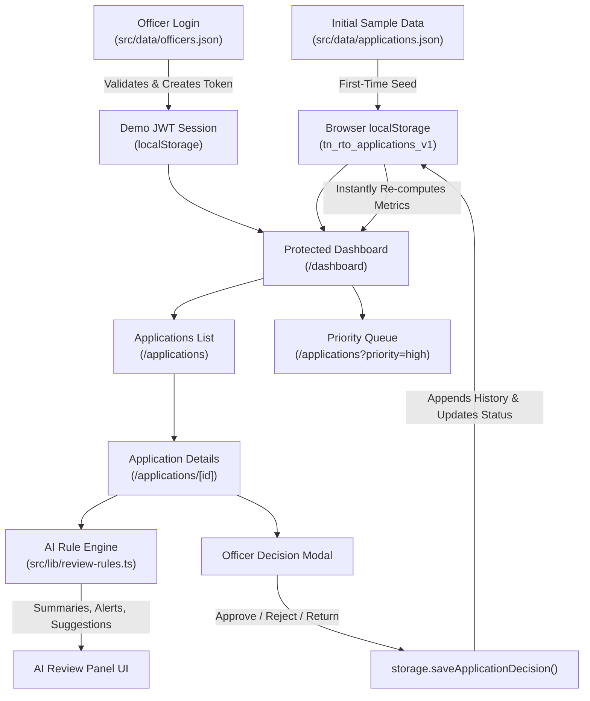

# தமிழ்நாடு ஓட்டுநர் உரிம விண்ணப்ப மறுஆய்வு முறைமை
## Tamil Nadu Driving Licence Application Review Officer Dashboard (RTO Portal)

> A Tamil-first, responsive administrative review dashboard for Regional Transport Office (RTO) officers in Tamil Nadu, powered by deterministic rule-based AI review assistance, JWT-compatible client session demo authentication, and browser persistence.

---

## 1. Project Name and Overview
- **Project Name:** Tamil Nadu Driving Licence Application Review Dashboard (`தமிழ்நாடு ஓட்டுநர் உரிம விண்ணப்ப மறுஆய்வு முறைமை`).
- **Overview:** A government administrative web application tailored for Motor Vehicle Inspectors (MVI) and Assistant Regional Transport Officers (ARTO/RTO) across Tamil Nadu. The portal streamlines the application review lifecycle across Learner's Licence (LL), Permanent Driving Licence (DL), and Licence Renewals. It features a Tamil-first interface, deterministic rule-based AI review assistance, multi-parameter filtering, priority queues, and audit decision logging.

---

## 2. Problem Statement
Government RTO officers review hundreds of driving licence applications daily across districts. In manual review pipelines:
1. Identifying missing mandatory documents (e.g., Form 1A medical certificates for applicants aged 40+, unverified driving school forms, or expired LLRs) is time-consuming and error-prone.
2. Inconsistent decision rationale and lack of instant validation checks can lead to citizen complaints and administrative delays.
3. Officers need an intuitive Tamil-native interface with instant rule-based assistance to accelerate approvals while strictly preserving human officer oversight and statutory accountability.

---

## 3. Target Users and Beneficiaries
- **Primary Users:**
  - **Motor Vehicle Inspectors (MVI - மோட்டார் வாகன ஆய்வாளர்கள்):** Review documents, verify driving school certificates, evaluate track tests, and record inspection remarks.
  - **Assistant Regional Transport Officers (ARTO - உதவி வட்டாரப் போக்குவரத்து அலுவலர்கள்):** Formally approve, reject with legal reason, or return applications for citizen corrections.
  - **RTO Headquarters Administrators:** Monitor state-wide application flow and status distributions.
- **Beneficiaries:**
  - Tamil Nadu citizens applying for licences, receiving timely, clear Tamil feedback on missing documents or approvals without bureaucratic delays.

---

## 4. Driving Licence Workflow Selected
The dashboard models three key statutory workflows under the Motor Vehicles Act:
1. **Learner's Licence (LL - பழகுநர் உரிமம்):**
   - Minimum age verification (18 years for LMV; 16 for non-geared 50cc).
   - Address and identity verification (Aadhaar, Voter ID).
   - Self-fitness declaration Form 1 & online road rules test check.
2. **Permanent Driving Licence (DL - ஓட்டுநர் உரிமம்):**
   - Active LLR verification (must have completed 30 days and be within 6 months).
   - Recognized driving school certificate Form 5 verification.
   - Track test & field evaluation results.
3. **Driving Licence Renewal (உரிமம் புதுப்பித்தல்):**
   - Expired licence verification.
   - **Form 1A Medical Certificate:** Mandatory for applicants aged 40+ issued by a registered medical practitioner.
   - Pending e-challan violations and no-objection status.

---

## 5. Features
- **Tamil-First Administrative UI:** All user-facing navigation, badges, statuses, decision dialogs, and validation messages rendered in natural, professional administrative Tamil.
- **Comprehensive Executive Metrics:** Instant counts for Total, Pending, Under Review, High Priority, Immediate Attention, Approved, Returned, and Rejected records.
- **Priority-Based Review Queue:** Surfacing urgent applicants (senior citizens, statutory employment applicants, risk-flagged records) for fast-track processing.
- **Interactive Multi-Filter & Search:** Real-time query search by application number, applicant name, or district, combined with multi-dropdown filters (Type, Status, District, Priority).
- **Rule-Based AI Review Assistance:** Deterministic engine evaluating document completeness, statutory age criteria, LLR validity, and medical certificates, generating:
  - Short summary (*விண்ணப்பச் சுருக்கம்*)
  - Missing document alerts (*விடுபட்ட ஆவணங்கள்*)
  - Inconsistency warnings (*கவனிக்க வேண்டிய முரண்பாடுகள்*)
  - Preliminary decision suggestion (*பரிந்துரைக்கப்படும் முடிவு*)
  - Statutory reasons (*காரணங்கள்*)
  - Recommended next steps (*அடுத்த கட்ட நடவடிக்கைகள்*)
- **Interactive AI Officer Chatbot (அலுவலர் AI உதவியாளர்):** Floating intelligent assistant styled with a dark rounded square and emerald sparkle star icon. Summarizes real-time office workload, highlights urgent high-priority applications, lists missing document flags, answers district-wise queries, and provides contextual 1-click summaries for any currently open application.
- **Officer Decision Workflow:**
  - Explicit Approve, Reject, or Return actions.
  - **Mandatory Reason Enforcement** for Rejection and Return decisions.
  - Confirmation step modal before finalizing decisions to prevent accidental submissions.
  - Immediate localStorage synchronization and metrics update.
- **Auditable Review History:** Chronological timeline capturing officer name, timestamp, action taken, and official remarks.
- **Demo Data Reset:** One-click confirmation modal restoring the original 14 fictional Tamil Nadu sample applications.
- **In-App Tamil User Manual:** Dedicated 10-section operational manual explaining every system feature with examples.

---

## 6. Technology Stack
- **Framework:** Next.js (App Router, React 19)
- **Language:** TypeScript 5 (Strict Mode)
- **Styling:** Tailwind CSS (Modern admin UI with Tamil font stack support)
- **Icons:** Lucide React
- **Authentication:** Demo JWT-compatible token generation and browser session management
- **Persistence:** Browser `localStorage` (seeded on first run from static JSON)
- **Bundler / Build:** Next.js with Webpack / Turbopack compatibility

---

## 7. Architecture and Data Flow



---

## 8. Folder Structure

```
web/
├── public/                     # Static public assets
├── src/
│   ├── app/
│   │   ├── layout.tsx          # Root layout with Tamil typography & metadata
│   │   ├── globals.css         # Tailwind styles & Tamil font family stack
│   │   ├── page.tsx            # Root redirector (Auth session check -> Dashboard/Login)
│   │   ├── login/
│   │   │   └── page.tsx        # Government officer login screen with demo autofill
│   │   ├── dashboard/
│   │   │   └── page.tsx        # Administrative dashboard with metrics & priority queue
│   │   ├── applications/
│   │   │   ├── page.tsx        # Searchable, filterable applications registry
│   │   │   └── [id]/
│   │   │       ├── page.tsx    # Dynamic route server component with generateStaticParams()
│   │   │       └── ApplicationDetailClient.tsx # Detailed view, checklist, AI panel, decision modal
│   │   └── manual/
│   │       └── page.tsx        # 10-section comprehensive Tamil user manual
│   ├── components/
│   │   ├── Navbar.tsx          # Government header with officer profile & reset CTA
│   │   ├── Sidebar.tsx         # Sidebar navigation with pending count badges
│   │   ├── StatusBadge.tsx     # Tamil status badges (Pending, Approved, Returned, etc.)
│   │   ├── PriorityBadge.tsx   # Priority indicators (High, Medium, Low)
│   │   ├── TypeBadge.tsx       # Licence type badges (LL, DL, Renewal)
│   │   ├── AiSuggestionBadge.tsx # Compact AI recommendation badge for tables
│   │   ├── AiReviewPanel.tsx   # Prominent rule-based AI review guidance card
│   │   ├── AiOfficerChatbot.tsx # Floating interactive AI chatbot assistant widget
│   │   ├── DecisionModal.tsx   # Two-step decision dialog with mandatory reasons
│   │   └── ResetConfirmModal.tsx # Confirmation dialog for data reset
│   ├── data/
│   │   ├── applications.json   # 14 fictional Tamil Nadu sample applications
│   │   ├── officers.json       # Demo RTO officer credentials & designations
│   │   ├── initial-applications.ts # Typed export of applications dataset
│   │   └── initial-officers.ts # Typed export of officers dataset
│   └── lib/
│       ├── types.ts            # TypeScript interfaces for entities, decisions, stats
│       ├── storage.ts          # LocalStorage persistence, seeding, query filters, metrics
│       ├── auth.ts             # Demo JWT token creation, expiry verification, sessions
│       ├── review-rules.ts     # Deterministic AI review rule engine
│       └── chatbot-engine.ts   # Natural language query parser & summary generator for officer chatbot
├── package.json
├── tsconfig.json
└── README.md
```

---

## 9. Sample Data Design
`src/data/applications.json` contains 14 realistic, fictional Tamil Nadu driving licence applications covering:
- **Application Types:** LL (5 records), DL (5 records), RENEWAL (4 records).
- **Districts:** சென்னை, கோயம்புத்தூர், மதுரை, திருச்சிராப்பள்ளி, சேலம், திருநெல்வேலி, தஞ்சாவூர், ஈரோடு, வேலூர், திண்டுக்கல், காஞ்சிபுரம், கன்னியாகுமரி.
- **Statuses:** `pending` (6), `under_review` (3), `approved` (2), `returned` (2), `rejected` (1).
- **Priorities:** `high` (5), `medium` (5), `low` (4).
- **Edge cases modeled:**
  - Minor applying for four-wheeler LMV (Age 17 -> Flagged & Suggests Rejection).
  - Renewal applicant aged 48 missing Form 1A Medical Certificate (Age > 40 -> Flagged & Suggests Return).
  - DL applicant with expired LLR (> 6 months validity exceeded -> Suggests Return).
  - Unnotarized rental agreement used as address proof -> Flagged for officer review.
  - Commercial driver with failed ophthalmic vision examination -> Flagged & Suggests Rejection.
  - Complete, flawless records with all tests passed -> Suggests Instant Approval.

---

## 10. AI-Assistance Rules and Limitations
### Rule Engine Implementation
The review assistant is implemented as a deterministic, rule-based TypeScript engine in [`src/lib/review-rules.ts`](file:///d:/ndev-projects/www.tnlicencereview.in/web/src/lib/review-rules.ts). It enforces Tamil Nadu transport regulations without any external cloud API or paid LLM service:
1. **Document Verification Rule:** Verifies that mandatory identity/address proofs, LLR copies, driving school Form 5, and Form 1A medical certificates are present and marked `verified`.
2. **Statutory Age Rule:** Enforces 18+ for LMV licence applications.
3. **Age 40+ Medical Rule:** Automatically requires Form 1A for renewal applicants aged 40 or older.
4. **LLR Validity Rule:** Checks that permanent DL applicants possess a valid LLR that is older than 30 days and younger than 180 days.
5. **Eligibility Verification:** Evaluates track test results, biometric verification, and challan clearances.

### Prominent Statutory Disclaimer
Every AI output card is stamped with:
> **“விதிமுறை அடிப்படையிலான தானியங்கி உதவி — இறுதி முடிவு அலுவலருடையது.”**  
> *(Rule-based automated assistance — Final decision rests with the authorized officer.)*

### Limitations
- The engine does not make automated legal decisions or execute approvals autonomously.
- It operates strictly over structured document status and metadata fields; it does not perform optical computer-vision OCR on raw scanned image files.

---

## 11. Demo Authentication Limitations
- **Demo-Only JWT Session:** Uses base64url-encoded headers and payloads structured identically to standard JWTs (`header.payload.signature`) with issuance (`iat`) and expiration (`exp`) timestamps.
- **Client-Side Boundary:** In this browser-only demonstration, session tokens are created and verified on the client side using localStorage.
- **Production Distinction:** In production, JWT issuance, digital signatures using asymmetric private keys (RS256 / EdDSA), and HttpOnly cookie transmission must be handled by an authenticated backend server integrated with the Tamil Nadu State Data Centre / e-Sevai / Parivahan SSO gateway. Real private signing keys are never placed in client-side code.

---

## 12. Data Persistence and Reset Behaviour
- **First Load Seeding:** On the first visit, the application reads the 14 sample applications from `src/data/applications.json` and seeds browser `localStorage` under the key `tn_rto_applications_v1`.
- **Decision Persistence:** Any approval, rejection, or return recorded by the officer immediately updates `localStorage`, appends a timestamped audit history entry, and recalculates dashboard metrics.
- **Data Reset:** Clicking **“மாதிரித் தரவை மீட்டமை”** in the top navigation opens a confirmation dialog. Upon confirmation, `localStorage` is cleared and re-initialized to the original 14 sample records.

---

## 13. Installation and Local Setup

### Prerequisites
- Node.js `v18.18.0` or higher (tested with `v22.13.1`)
- npm `v9.0.0` or higher (tested with `10.9.2`)

### Steps
1. Navigate to the project directory:
   ```bash
   cd D:\ndev-projects\www.tnlicencereview.in\web
   ```
2. Install dependencies:
   ```bash
   npm install
   ```

---

## 14. Environment Variables
No external environment variables or paid API keys are required. The application runs self-contained without third-party services.

---

## 15. Development and Production Build Commands
- **Start Development Server:**
  ```bash
  npm run dev
  ```
  Open [http://localhost:3000](http://localhost:3000) in your browser.

- **Run Type Check:**
  ```bash
  npx tsc --noEmit
  ```

- **Build Production Bundle:**
  ```bash
  npm run build
  ```
  *(Pre-renders all 23 routes and subpages statically).*

- **Start Production Server:**
  ```bash
  npm run start
  ```

---

## 16. Demo Login Credentials

| Role / Designation | RTO Office | Username | Password |
|---|---|---|---|
| **மு. கார்த்திகேயன் (MVI)** | சென்னை மத்திய RTO (TN-01) | `officer_chennai` | `tn_rto_2026` |
| **சு. லட்சுமி (ARTO)** | கோயம்புத்தூர் தெற்கு RTO (TN-38) | `officer_kovai` | `tn_rto_2026` |
| **எஸ். ராமநாதன் (RTO Admin)** | தமிழ்நாடு போக்குவரத்துத் தலைமையகம் | `admin` | `admin123` |

*Note: The login page includes convenient one-click demo credential autofill buttons.*

---

## 17. Testing Instructions
1. **Login & Session:**
   - Go to `/login`, click the `officer_kovai` autofill button, and log in.
   - Verify redirection to `/dashboard` with logged-in officer name displayed in Tamil.
2. **Search & Filters:**
   - On `/dashboard` or `/applications`, type `"அன்பரசன்"` in the search box; verify matching records appear instantly.
   - Filter by Application Type: `பழகுநர் உரிமம் (LL)`, Status: `நிலுவையில் உள்ளது`, or Priority: `உயர் முன்னுரிமை`.
3. **AI Assistance Inspection:**
   - Click **“ஆய்வு செய்”** on application `TN-2026-RN-30114` (வ. சிவகுமார், வயது 48).
   - Observe the AI guidance card:
     - *விண்ணப்பச் சுருக்கம்:* விடுபட்ட மருத்துவ சான்றிதழ் படிவம் 1A.
     - *பரிந்துரை:* திருத்தத்திற்கு திருப்பி அனுப்ப பரிந்துரைக்கப்படுகிறது.
     - *காரணம்:* 40 வயதுக்கு மேற்பட்டோருக்கு மருத்துவ படிவம் 1A கட்டாயம்.
4. **Officer Decision Workflow:**
   - Click **“அலுவலர் முடிவை மாற்றுக”**.
   - Select **“திருப்பி அனுப்பு”**; verify that leaving the reason blank triggers a validation error.
   - Enter reason: `"40 வயது பூர்த்தியானதால் படிவம் 1A மருத்துவ சான்றிதழை பதிவேற்றவும்."`
   - Proceed to confirmation and submit.
   - Verify Tamil success notification, immediate status update to `Returned`, and recalculated dashboard metrics.
5. **Resetting Data:**
   - Click **“மாதிரித் தரவை மீட்டமை”** in the top navigation, confirm the modal, and observe all counts returning to initial seed state.
6. **User Manual:**
   - Navigate to `/manual` and explore the 10-section operational guide with tables of contents and practical examples.

---

## 18. Deployment Instructions
The application is fully compatible with static hosting or serverless deployment (Vercel, Netlify, Cloudflare Pages, AWS Amplify):
1. **Deploying on Vercel:**
   ```bash
   npx vercel
   ```
2. Build command: `npm run build`
3. Output directory: `.next`

---

## 19. Security and Privacy Limitations
1. **Fictional Demonstration Data:** No real citizen identity numbers, real Aadhaar numbers, or authentic government officer credentials are used or stored.
2. **Client-Side Simulation:** Demonstration authentication does not store private cryptographic keys on a server; it serves strictly to illustrate role-based session workflows and route guards.
3. **Not an Official Government System:** This project is an independent technical evaluation assignment and is not affiliated with the Government of Tamil Nadu or the Ministry of Road Transport and Highways (MoRTH).

---

## 20. Future Production Improvements
1. **Backend Integration:** Replace localStorage with an enterprise PostgreSQL / Hasura GraphQL backend connected via RESTful microservices.
2. **Server-Side Asymmetric Auth:** Integrate OAuth2 / OpenID Connect with Tamil Nadu Single Sign-On (TN-SSO) and Parivahan Sarathi APIs using RS256 JWTs with HttpOnly secure cookies.
3. **Document OCR & Tamper Detection:** Integrate an automated document image processing pipeline with signature/seal detection and Aadhaar QR validation.
4. **SMS / WhatsApp Gateway:** Automated citizen SMS notifications in Tamil upon application approval, return, or rejection.
5. **Multi-Role RBAC:** Granular permission boundaries differentiating MVI inspection remarks from ARTO sign-off authority.

## 11. Demo Authentication Limitations
- **Demo-Only JWT Session:** Uses base64url-encoded headers and payloads structured identically to standard JWTs (`header.payload.signature`) with issuance (`iat`) and expiration (`exp`) timestamps.
- **Client-Side Boundary:** In this browser-only demonstration, session tokens are created and verified on the client side using localStorage.
- **Production Distinction:** In production, JWT issuance, digital signatures using asymmetric private keys (RS256 / EdDSA), and HttpOnly cookie transmission must be handled by an authenticated backend server integrated with the Tamil Nadu State Data Centre / e-Sevai / Parivahan SSO gateway. Real private signing keys are never placed in client-side code.

---

## 12. Data Persistence and Reset Behaviour
- **First Load Seeding:** On the first visit, the application reads the 14 sample applications from `src/data/applications.json` and seeds browser `localStorage` under the key `tn_rto_applications_v1`.
- **Decision Persistence:** Any approval, rejection, or return recorded by the officer immediately updates `localStorage`, appends a timestamped audit history entry, and recalculates dashboard metrics.
- **Data Reset:** Clicking **“மாதிரித் தரவை மீட்டமை”** in the top navigation opens a confirmation dialog. Upon confirmation, `localStorage` is cleared and re-initialized to the original 14 sample records.

---

## 13. Installation and Local Setup

### Prerequisites
- Node.js `v18.18.0` or higher (tested with `v22.13.1`)
- npm `v9.0.0` or higher (tested with `10.9.2`)

### Steps
1. Navigate to the project directory:
   ```bash
   cd D:\ndev-projects\www.tnlicencereview.in\web
   ```
2. Install dependencies:
   ```bash
   npm install
   ```

---

## 14. Environment Variables
No external environment variables or paid API keys are required. The application runs self-contained without third-party services.

---

## 15. Development and Production Build Commands
- **Start Development Server:**
  ```bash
  npm run dev
  ```
  Open [http://localhost:3000](http://localhost:3000) in your browser.

- **Run Type Check:**
  ```bash
  npx tsc --noEmit
  ```

- **Build Production Bundle:**
  ```bash
  npm run build
  ```
  *(Pre-renders all 23 routes and subpages statically).*

- **Start Production Server:**
  ```bash
  npm run start
  ```

---

## 16. Demo Login Credentials

| Role / Designation | RTO Office | Username | Password |
|---|---|---|---|
| **மு. கார்த்திகேயன் (MVI)** | சென்னை மத்திய RTO (TN-01) | `officer_chennai` | `tn_rto_2026` |
| **சு. லட்சுமி (ARTO)** | கோயம்புத்தூர் தெற்கு RTO (TN-38) | `officer_kovai` | `tn_rto_2026` |
| **எஸ். ராமநாதன் (RTO Admin)** | தமிழ்நாடு போக்குவரத்துத் தலைமையகம் | `admin` | `admin123` |

*Note: The login page includes convenient one-click demo credential autofill buttons.*

---

## 17. Testing Instructions
1. **Login & Session:**
   - Go to `/login`, click the `officer_kovai` autofill button, and log in.
   - Verify redirection to `/dashboard` with logged-in officer name displayed in Tamil.
2. **Search & Filters:**
   - On `/dashboard` or `/applications`, type `"அன்பரசன்"` in the search box; verify matching records appear instantly.
   - Filter by Application Type: `பழகுநர் உரிமம் (LL)`, Status: `நிலுவையில் உள்ளது`, or Priority: `உயர் முன்னுரிமை`.
3. **AI Assistance Inspection:**
   - Click **“ஆய்வு செய்”** on application `TN-2026-RN-30114` (வ. சிவகுமார், வயது 48).
   - Observe the AI guidance card:
     - *விண்ணப்பச் சுருக்கம்:* விடுபட்ட மருத்துவ சான்றிதழ் படிவம் 1A.
     - *பரிந்துரை:* திருத்தத்திற்கு திருப்பி அனுப்ப பரிந்துரைக்கப்படுகிறது.
     - *காரணம்:* 40 வயதுக்கு மேற்பட்டோருக்கு மருத்துவ படிவம் 1A கட்டாயம்.
4. **Officer Decision Workflow:**
   - Click **“அலுவலர் முடிவை மாற்றுக”**.
   - Select **“திருப்பி அனுப்பு”**; verify that leaving the reason blank triggers a validation error.
   - Enter reason: `"40 வயது பூர்த்தியானதால் படிவம் 1A மருத்துவ சான்றிதழை பதிவேற்றவும்."`
   - Proceed to confirmation and submit.
   - Verify Tamil success notification, immediate status update to `Returned`, and recalculated dashboard metrics.
5. **Resetting Data:**
   - Click **“மாதிரித் தரவை மீட்டமை”** in the top navigation, confirm the modal, and observe all counts returning to initial seed state.
6. **User Manual:**
   - Navigate to `/manual` and explore the 10-section operational guide with tables of contents and practical examples.

---

## 18. Deployment Instructions
The application is fully compatible with static hosting or serverless deployment (Vercel, Netlify, Cloudflare Pages, AWS Amplify):
1. **Deploying on Vercel:**
   ```bash
   npx vercel
   ```
2. Build command: `npm run build`
3. Output directory: `.next`

---

## 19. Security and Privacy Limitations
1. **Fictional Demonstration Data:** No real citizen identity numbers, real Aadhaar numbers, or authentic government officer credentials are used or stored.
2. **Client-Side Simulation:** Demonstration authentication does not store private cryptographic keys on a server; it serves strictly to illustrate role-based session workflows and route guards.
3. **Not an Official Government System:** This project is an independent technical evaluation assignment and is not affiliated with the Government of Tamil Nadu or the Ministry of Road Transport and Highways (MoRTH).

---

## 20. Future Production Improvements
1. **Backend Integration:** Replace localStorage with an enterprise PostgreSQL / Hasura GraphQL backend connected via RESTful microservices.
2. **Server-Side Asymmetric Auth:** Integrate OAuth2 / OpenID Connect with Tamil Nadu Single Sign-On (TN-SSO) and Parivahan Sarathi APIs using RS256 JWTs with HttpOnly secure cookies.
3. **Document OCR & Tamper Detection:** Integrate an automated document image processing pipeline with signature/seal detection and Aadhaar QR validation.
4. **SMS / WhatsApp Gateway:** Automated citizen SMS notifications in Tamil upon application approval, return, or rejection.
5. **Multi-Role RBAC:** Granular permission boundaries differentiating MVI inspection remarks from ARTO sign-off authority.

